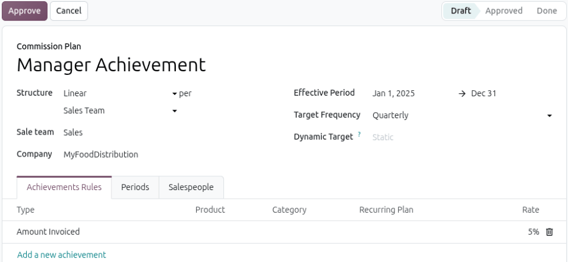

.. meta::
   :description: Enable the Commissions feature in the Odoo Sales app and create commission plans
                 that reward salespeople or sales teams, using either a Linear structure with a
                 single commission rate or a Tiered structure with commission levels based on the
                 percentage of sales targets reached.

===========
Commissions
===========

.. |SOs| replace:: :abbr:`SOs (Sales Orders)`

Commissions are a powerful tool to motivate sales team members. They incentivize performance, boost
productivity, and encourage healthy competition. The *Commissions* feature in Odoo's **Sales**
application provides a way to reward salespeople or sales teams based on their performance. This
feature supports the creation of flexible, measurable commission structures that align with business
goals, whether that means driving revenue, volume, profit, or recurring contracts.

Configuration
=============

To enable the *Commissions* feature, navigate to :menuselection:`Sales app --> Configuration -->
Settings`. Scroll to the :guilabel:`Invoicing` section, and tick the :guilabel:`Commissions`
checkbox. Then, click :guilabel:`Save`. Doing so causes a new :guilabel:`Commissions` menu to appear
in the menu bar. To create a new commission plan, navigate to :menuselection:`Commissions -->
Commission Plans` and click :guilabel:`New`.

.. _sales/commissions/commission-plan:

Create a commission plan
========================

To fill out a commission plan, follow these steps:

#. Enter the name of the plan in the :guilabel:`Commission Plan` field.
#. Select either :ref:`Linear<sales/commissions/linear>` or :ref:`Tiered<sales/commissions/tiered>`
   in the :guilabel:`Structure` drop-down menu to determine how the commissions are awarded.
#. Choose if the plan applies to individual salespeople or an entire sales team in the
   :guilabel:`per` drop-down menu.
#. Select the beginning and end dates for the :guilabel:`Effective Period` field. The date range
   cannot be more than a year.
#. Select one of the :guilabel:`Target Frequency` drop-down menu options to set how often targets
   reset: :guilabel:`Monthly`, :guilabel:`Quarterly`, or :guilabel:`Yearly`.

   + *Monthly*: Short-term goals with frequent payouts.
   + *Quarterly*: Aligns with business cycles and provides mid-range objectives.
   + *Yearly*: Long-term sales goals for strategic planning.

#. Select a :guilabel:`Dynamic Target` from the drop-down menu. The dynamic target of a salesperson
   is the sum of the targets of their subordinates on the following plans. Leave this field empty to
   specify a static target in the *Targets* tab.
#. In the :ref:`Achievements Rules <sales/commissions/achievement-metric>` tab, select options from
   the drop-down menu to determine what is being measured toward commissions.

.. _sales/commissions/achievement-metric:

Select achievement rules
------------------------

Performance can be measured in several ways in commission plans. These are configured in the
*Achievements Rules* tab of each plan. It is possible to track achievements by all products sold, by
specific products sold, by all products sold in a specific category, and more.

- :guilabel:`Amount Sold`: The total value of sales orders (SOs).
- :guilabel:`Amount Invoiced`: The total value of confirmed invoices.
- :guilabel:`Amount Paid in Full`: The total value of fully paid invoices based on the date they
  were paid.
- :guilabel:`Quantity Sold`: The total number of units sold via |SOs|.
- :guilabel:`Quantity Invoiced`: The total number of units invoiced.
- :guilabel:`Margin`: The profit margin (selling price minus cost price).
- :guilabel:`MRR`: The *Monthly Recurring Revenue* from subscription sales. This option is **only**
  available if the :doc:`Subscriptions <../../sales/subscriptions>` app is installed.

.. note::
   Regardless of what the :guilabel:`Structure` of a plan is, each plan needs both *Achievements
   Rules* and *Targets* configured.

.. _sales/commissions/periods:

Periods
-------

The *Periods* tab populates based on the selection of the :guilabel:`Target Frequency` field.

.. _sales/commissions/salespeople:

Assign salespeople
------------------

To allow for more robust achievement tracking, the **Sales** app makes it possible to list the same
salesperson twice on the list to take into account team membership changes. In a team leader plan
scenario, the team lead can be listed multiple times to track when a team member leaves or joins.

To assign salespeople to a commission plan, follow these steps:

1. Select the appropriate staff to assign to the commission plan in the *Salespeople* tab. In the
   :guilabel:`Salesperson` column, click either :guilabel:`Add a new Salesperson` to add them
   individually, or the :guilabel:`Add Multiple Salespersons` button to bulk add several at once.
#. Select a date from the calendar pop-up window for the :guilabel:`From` and :guilabel:`To` columns
   to create the date range during which the commission plan tracks the staff's progress.
#. Select the appropriate staff for the :guilabel:`Sum of achievements` column. The |SOs| and
   invoices of these users are added to the achievements of the assigned salesperson. This column is
   only available if :guilabel:`Salesperson` is selected for the :guilabel:`per` field.
#. If the salesperson is a part of another commission plan, that plan auto-populates in the
   :guilabel:`Other plans` column.

.. _sales/commissions/linear:

Linear-based commission plans
-----------------------------

A *Linear*-based commission plan, also known as an achievement-based plan, calculates the
salesperson's commission by selecting a performance metric and multiplying it by a single commission
rate. Achievement-based plans are ideal for rewarding sales activity consistently, regardless of
specific goals. For example, a plan might offer a `5%` commission on all invoiced amounts,
regardless of how much is sold.

.. tip::
   Achievement-based plans differ from *Tiered*-based plans because they are calculated based on
   actual achievements using a flat, consistent rate. They are beneficial for ongoing,
   non-goal-based compensation plans.

To configure a new *Linear*-based commission plan, navigate to the :menuselection:`Sales app -->
Commissions --> Commission Plans`, then click :guilabel:`New`.

1. Click in the :guilabel:`Structure` drop-down and select :guilabel:`Linear`.
#. Select an option in the :guilabel:`per` field.
#. Choose the :guilabel:`Effective Period` fields to confirm the dates for this plan.
#. Select the :guilabel:`Target Frequency` field based on how often the targets should be set and
   evaluated.
#. Add :ref:`Achievement metrics <sales/commissions/achievement-metric>` for this plan by clicking
   :guilabel:`Add a new achievement` on the *Achievements Rules* tab.
#. Click the *Salespeople* tab to assign this plan to the appropriate staff. Click either
   :guilabel:`Add a new Salesperson` to add them individually, or :guilabel:`Add Multiple
   Salespersons` to bulk add several at once.

.. _sales/commissions/tiered:

Tiered-based commission plans
-----------------------------

In a *Tiered*-based commission plan, commissions are awarded based on the percentage of sales
targets reached. Tiered-based plans are ideal for setting clear, measurable goals, such as invoicing
a specific amount in sales per quarter, then rewarding salespeople progressively based on how close
they come to reaching or exceeding that goal.

.. tip::
   *Tiered*-based plans differ from *Linear*-based plans because they are based on reaching a fixed,
   predefined goal. They focus on goal-based incentives and performance milestones.

To configure a new *Tiered*-based commission plan, navigate to the :menuselection:`Sales app -->
Commissions --> Commission Plans`, then click :guilabel:`New`.

1. Click in the :guilabel:`Structure` drop-down menu and select :guilabel:`Tiered`.
#. Select an option in the :guilabel:`per` field.
#. In the :guilabel:`On Target Commission` field, set the payout amount for reaching `100%` of the
   target.
#. Choose the :guilabel:`Effective Period` fields to confirm the dates for this plan.
#. Select the :guilabel:`Target Frequency` field based on how often the targets should be set and
   evaluated.

   .. note::
      After the :guilabel:`Target Frequency` field is configured, the *Targets* tab updates with a
      list of periods for the selected time frame.

#. In the *Commissions* tab, click :guilabel:`Add a new commission level` to add :ref:`commission
   levels <sales/commissions/levels>` for the plan.
#. In the new line, enter the percentage value for the :guilabel:`Target completion (%)` column and
   the monetary value in the :guilabel:`Commission` column.
#. In the *Targets* tab, enter a :guilabel:`Target` goal for each :guilabel:`Period`.
#. On the *Achievements Rules* tab, click :guilabel:`Add a new achievement` to add one or more
   :ref:`Achievement metrics <sales/commissions/achievement-metric>`.
#. Click the *Salespeople* tab to assign this plan to the appropriate staff. Click :guilabel:`Add a
   new Salesperson` to add them individually.

   .. note::
      The :guilabel:`Add Multiple Salespersons` button is only available if
      :doc:`../../general/developer_mode` is active.

.. _sales/commissions/levels:

Levels
------

To provide additional incentive, *commission levels* can be added to *Tiered*-based plans. These
tiers allow salespeople to earn varying commission amounts based on their performance levels. Levels
can start at `0%` and increase incrementally. This allows salespeople to earn commission even if
they do not achieve `100%` of the target, and to earn more if they exceed it. Commission levels can
be set from the *Commissions* tab when creating a *Tiered*-based commission plan.

If no levels are added above `100%`, salespeople are **not** able to earn above the stated
commission.

To filter or edit the *Commissions* tab list:

- Click the :icon:`arrow_upward` :guilabel:`(up arrow)` icon to sort the list from highest level to
  lowest or the :icon:`arrow_downward` :guilabel:`(down arrow)` icon for lowest to highest. The
  :icon:`swap_vert` :guilabel:`(up down arrows)` icon resets the list to the default listing (lowest
  to highest).
- Click the :icon:`tune` :guilabel:`(filter)` icon to open the drop-down menu to enable the
  :guilabel:`OTC %` column.
- Click the :icon:`delete` :guilabel:`(delete)` icon to remove a commission level entry from the
  list.

.. example::
   In the plan below, the levels start at `0%` and continue until `300%`. If a salesperson exceeds
   `100%` of the expected target, their expected payout continues to increase up to `300%`.

   .. image:: commissions/commission-levels.png
      :alt: An example of commission levels, with levels above 100 percent.

.. _sales/commissions/plan-approval:

Plan approval
=============

After confirming the details of the new plan, click :guilabel:`Approve`. This moves the plan from
the :guilabel:`Draft` stage into the :guilabel:`Approved` stage.

.. important::
   Commission plans in the :guilabel:`Approved` stage **cannot** be edited. To edit an approved
   plan, first click :guilabel:`Reset to Draft`.

After a plan is approved, Odoo automatically tracks performance and calculates commissions based on
the established parameters.

.. seealso::
   :doc:`Commissions <../../hr/payroll/commissions>`
